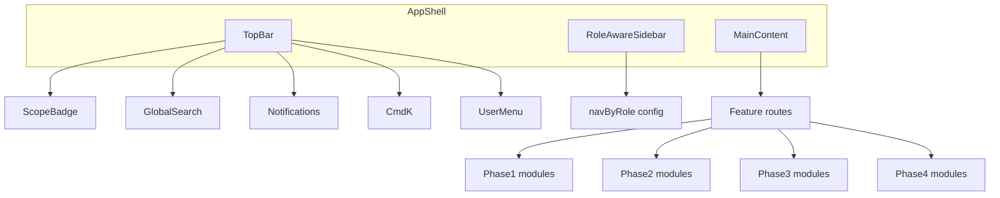

# Frontend Implementation Plan — Real Estate CRM

**Audience:** Frontend engineering team  
**Goal:** Build a production-ready, role-aware CRM SPA (plus portal tracks) aligned to the SRS  
**Design system:** [`ui-ux-design-principle-coloring.md`](ui-ux-design-principle-coloring.md)  
**Role menus:** [`Real-Estate-CRM-Role-Based-Dashboard Designs.md`](Real-Estate-CRM-Role-Based-Dashboard%20Designs.md)  
**Requirements:** [`full-featured-web-based-real-estate-crm-srs.md`](full-featured-web-based-real-estate-crm-srs.md)  
**Phase 1 schedule:** [`Real-Estate-CRM-Implementation-Two-Week-Sprint.md`](Real-Estate-CRM-Implementation-Two-Week-Sprint.md)

This document is the single source of truth for **every frontend page**, navigation, components, colors, and phased delivery. Implement in phase order. Do not skip Foundation.

---

## Table of contents

1. [Overview & goals](#1-overview--goals)
2. [Tech stack](#2-tech-stack)
3. [Architecture](#3-architecture)
4. [Design system reference](#4-design-system-reference)
5. [Shared component library](#5-shared-component-library)
6. [Role-based navigation matrix](#6-role-based-navigation-matrix)
7. [Shell & cross-cutting pages](#7-shell--cross-cutting-pages)
8. [Phase 1 — MVP pages](#8-phase-1--mvp-pages)
9. [Phase 2 — Automation & Connectivity](#9-phase-2--automation--connectivity)
10. [Phase 3 — Financial Depth & Compliance](#10-phase-3--financial-depth--compliance)
11. [Phase 4 — Enterprise & Advanced](#11-phase-4--enterprise--advanced)
12. [Build sequence & milestones](#12-build-sequence--milestones)
13. [Engineering standards & definition of done](#13-engineering-standards--definition-of-done)

---

## 1. Overview & goals

### Product surfaces (do not conflate)

| Surface | Tech | Users | Phase |
| :--- | :--- | :--- | :--- |
| **Internal CRM SPA** | React + Vite | Agents, managers, finance, marketing, admin | 1–4 |
| **Public property portal** | Next.js (SSR/ISR) | Anonymous visitors | 4 |
| **Client portal** | React route group or light SPA | Buyers, sellers, tenants, landlords | 4 |
| **Native mobile** | React Native | Field agents | 4 |

### Frontend goals

- Never lose a lead; make Status / Owner / Budget / Next Action visible in **3 seconds**.
- Role-aware UI: each of 8 roles sees only relevant nav and scoped data (SRS 2.3, 3.17).
- Consistent design system across modules (SRS 4.1).
- List views: column config, sort, filter, **saved views** (SRS 4.1).
- WCAG 2.1 AA; P95 list/dashboard load ≤ 2s (SRS 5.1, 5.4).

### SRS phase map

| Phase | Name | Frontend focus |
| :--- | :--- | :--- |
| **0** | Foundation | Design tokens, shell, components, role nav |
| **1** | MVP | Dashboards, Leads, Contacts, Properties, Pipeline, Settings |
| **2** | Automation & Connectivity | Calendar, Comms, Marketing, Leases, Documents |
| **3** | Financial Depth | Transactions, Commissions, Invoices, Advanced reports |
| **4** | Enterprise & Advanced | Multi-branch, portals, Maintenance, AI, Admin/Integrations, Mobile |

---

## 2. Tech stack

| Concern | Choice | Why |
| :--- | :--- | :--- |
| SPA | React 18 + TypeScript + Vite | Fast DX; matches SRS 6.2 |
| Styling | Tailwind CSS + shadcn/ui (Radix) | Dense CRM UI; accessible primitives |
| Server state | TanStack Query | Lists, caches, mutations (~90% of CRM state) |
| Tables | TanStack Table | Saved views, sort, filter, column config |
| Kanban / DnD | `@dnd-kit` | Pipeline + calendar drag |
| Forms | React Hook Form + Zod | Validation; generate Zod from OpenAPI where possible |
| Charts | Recharts | Dashboard KPIs |
| Routing | React Router v6 | Nested layouts, role guards |
| Toasts | Sonner | Non-blocking feedback |
| Icons | Lucide | Consistent stroke icons |
| API types | `openapi-typescript` from DRF schema | End-to-end type safety |
| Public portal | **Next.js** | SEO for listing pages (SRS 3.11.1) |
| Mobile | React Native | Same API (Phase 4) |

**Client UI state only** (Zustand or equivalent): theme, sidebar open, command-palette open, draft filters. Do not put server data in Zustand.

---

## 3. Architecture

### 3.1 App shell



- **Left sidebar** (~240px): role-filtered nav groups from Section 6.
- **Top bar:** scope badge, global search, notifications, theme toggle, user menu.
- **Main:** `max-w-7xl` content area; drawers/modals overlay.
- **Mobile:** collapsible sidebar; primary actions in bottom sheets.

### 3.2 Suggested folder structure

```
frontend/src/
  app/                 # providers, router, guards
  components/
    ui/                # shadcn primitives
    shared/            # DataTable, Kanban, Timeline, PageHeader, …
  features/
    auth/
    dashboard/
    leads/
    contacts/
    properties/
    pipeline/
    settings/
    calendar/          # Phase 2
    communications/    # Phase 2
    marketing/         # Phase 2
    leases/            # Phase 2
    documents/         # Phase 2
    finance/           # Phase 3
    reports/           # Phase 3
    maintenance/       # Phase 4
    admin/             # Phase 4
    ai/                # Phase 4
    portal/            # Phase 4 client portal routes
  lib/                 # api client, auth, status tones, format, cn
  hooks/
  types/               # generated OpenAPI + domain types
```

### 3.3 Data & auth conventions

- JWT access + refresh; `Authorization: Bearer` on all API calls.
- Tenant isolation is enforced by the API; UI still shows **scope badge** and never trusts client-only filters for security.
- Every list: `useQuery` with key `['resource', filters, page]`; mutations invalidate related keys.
- Permission gating: `<Can permission="leads.create">` / route `RequireRole`; hide nav items the role cannot access.
- Soft errors: toast + inline form errors; hard errors: error boundary + `/error`.

### 3.4 Routing conventions

| Pattern | Example |
| :--- | :--- |
| List | `/leads`, `/contacts`, `/properties` |
| Detail (full page when needed) | `/leads/:id`, `/properties/:id` |
| Prefer slide-over for CRM density | Row click → Sheet (450px) |
| Nested settings | `/settings/profile`, `/settings/custom-fields` |
| Portal (separate layout) | `/portal/*` |
| Public site | Next.js app, not CRM SPA |

---

## 4. Design system reference

**Implement tokens exactly as defined in** [`ui-ux-design-principle-coloring.md`](ui-ux-design-principle-coloring.md).

| Topic | Rule |
| :--- | :--- |
| Brand | Blue-600 `#2563EB` via `--primary` |
| Surfaces | Canvas / card / muted via CSS variables |
| Status | Soft BG + dark text badges; use `StatusBadge` + tone maps |
| Density | `text-sm` tables/forms; `text-xs` badges |
| Dark mode | `.dark` class on `<html>`; class strategy |
| Touch | ≥44×44px mobile targets |
| Scope | Always visible in header |

---

## 5. Shared component library

Build these once in Foundation; every module reuses them.

| Component | Spec | SRS |
| :--- | :--- | :--- |
| **Button / Input / Select / Textarea / Label** | shadcn; input `h-10` focus ring brand | 4.1 |
| **Badge / StatusBadge** | Semantic matrix from design system | — |
| **PageHeader** | Title, description, primary + secondary actions | — |
| **DataTable** | Sort, filter, column visibility, pagination, **saved views**, row click → sheet | 4.1 |
| **EmptyState / Skeleton** | Match layout shape; no full-page spinner | 5.4 |
| **Sheet (slide-over)** | 450px default; 600px for rich 360 profiles | — |
| **Dialog / ConfirmDialog** | Destructive confirms (merge, delete, mark lost) | — |
| **Tabs** | Detail sections (Overview / Timeline / Docs) | — |
| **KanbanBoard / KanbanCard** | Columns, DnD, stage totals, drag feedback | 3.4.1 |
| **ActivityTimeline** | Omnichannel borders (WhatsApp/Email/Call/Note) | 3.2.4, 3.9 |
| **StatCard / KPI strip** | Label, value, delta, sparkline optional | 3.13 |
| **Chart wrappers** | Line / bar / pie via Recharts | 3.13 |
| **CommandPalette** | Cmd/Ctrl+K → navigate + quick create | — |
| **GlobalSearch** | Contacts, leads, properties, deals | 4.1 |
| **FileUpload / MediaGallery** | Drag-drop, reorder, cover image | 3.3.3 |
| **MapSearch** | Radius / map-drawn filter (Phase 1 property search) | 3.3.7 |
| **Wizard / Stepper** | Multi-step create (lease, onboarding) | — |
| **NotificationCenter** | In-app list; unread; deep links | 3.18 |
| **ScopeBadge** | Branch / team / “My only” | 3.15 |
| **Can / RequireRole** | Permission wrappers | 3.17 |

---

## 6. Role-based navigation matrix

Single config file: `navByRole[role] → NavGroup[]`. Filter by feature flags + permissions. Icons via Lucide (no emoji in production UI).

### 6.1 Roles

| Role key | Label | Primary focus |
| :--- | :--- | :--- |
| `super_admin` | Super Admin | Tenants, security, billing |
| `owner` | Broker / Agency Owner | Agency KPIs, teams, finance |
| `manager` | Branch / Team Manager | Team pipeline, performance |
| `agent` | Sales / Leasing Agent | Own leads, deals, calendar |
| `property_manager` | Property Manager | Leases, tenants, maintenance |
| `marketing` | Marketing Staff | Campaigns, ROI |
| `finance` | Finance Staff | Commissions, invoices |
| `portal_user` | Portal User | Own deals / lease only |

### 6.2 Sidebar by role (routes)

#### Super Admin

| Group | Items → Route | Phase |
| :--- | :--- | :--- |
| Dashboard | Overview `/`, System Analytics `/admin/analytics`, Quick Actions | 1 / 4 |
| Administration | Users `/admin/users`, Roles `/admin/roles`, Tenants `/admin/tenants`, System Settings `/admin/settings`, Audit Log `/admin/audit`, Backup `/admin/backup` | 4 |
| Reports | System `/reports/system`, Revenue `/reports/revenue`, Usage `/reports/usage` | 3–4 |
| Integrations | Email `/admin/integrations/email`, SMS/WhatsApp `/admin/integrations/sms`, API Keys `/admin/api-keys`, Webhooks `/admin/webhooks` | 4 |
| Subscriptions | Plans `/admin/billing/plans`, Invoices `/admin/billing/invoices`, Customers `/admin/billing/customers` | 4 |
| Help | Docs / Support / Training (external or `/help`) | 1 |

#### Broker / Agency Owner

| Group | Items → Route | Phase |
| :--- | :--- | :--- |
| Dashboard | Agency overview `/` | 1 |
| Leads | All `/leads`, Analytics `/leads/analytics`, Assignment rules `/leads/routing`, Sources `/leads/sources` | 1 |
| Properties | All `/properties`, Inventory `/properties/inventory`, Projects `/projects`, Analytics `/properties/analytics` | 1 |
| Deals | Overview `/pipeline`, Sales `/pipeline/sales`, Leasing `/pipeline/leasing`, Forecast `/pipeline/forecast` | 1 |
| Team | Agents `/team/agents`, Performance `/team/performance`, Branches `/team/branches`, Commission plans `/finance/commission-plans` | 1 / 3 |
| Finance | Transactions `/finance/transactions`, Commissions `/finance/commissions`, Reports `/finance/reports`, Invoices `/finance/invoices` | 3 |
| Reports | Agency `/reports`, Leaderboard `/reports/leaderboard`, ROI `/reports/roi`, Custom `/reports/builder` | 3 |
| Settings | Branch `/settings/branches`, Commission rules `/settings/commissions`, Localization `/settings/localization`, Security `/settings/security` | 1 / 4 |

#### Branch / Team Manager

Same as Owner but **scoped to branch/team**; hide agency-wide billing. Emphasize: team pipeline, agent performance, lead routing for branch.

#### Sales / Leasing Agent

| Group | Items → Route | Phase |
| :--- | :--- | :--- |
| Dashboard | My performance `/` | 1 |
| Leads | My `/leads`, Hot `/leads?filter=hot`, Follow-ups `/leads?filter=followups`, Add (action) | 1 |
| Contacts | My `/contacts`, Buyers/Sellers/Tenants (saved views), Add | 1 |
| Properties | My listings `/properties`, Search `/properties/search`, Units `/projects`, Add | 1 |
| Deals | My pipeline `/pipeline`, Sales/Leasing, Won `/pipeline?status=won`, Lost `/pipeline?status=lost` | 1 |
| Calendar | Calendar `/calendar`, Viewings `/calendar?type=viewing`, Tasks `/tasks` | 2 |
| Communications | Inbox `/comms`, Templates `/comms/templates` | 2 |
| Documents | My `/documents`, Templates `/documents/templates` | 2 |
| Reports | My performance `/reports/me`, Commission `/finance/commissions?mine=1` | 3 |
| Settings | Profile `/settings/profile`, Notifications `/settings/notifications` | 1 |

#### Property Manager

| Group | Items → Route | Phase |
| :--- | :--- | :--- |
| Dashboard | Portfolio `/` | 1 (KPI shell) / 2 data |
| Properties | Managed `/properties?managed=1`, Units `/projects` | 1 |
| Leases | Active `/leases`, Expiring `/leases?filter=expiring`, Renewals, Terminations | 2 |
| Tenants | All `/contacts?role=tenant`, Add | 1 |
| Rent | Invoices `/leases/rent`, Payments, Late `/leases/rent?status=late`, Reports | 2 |
| Maintenance | Work orders `/maintenance`, Vendors `/maintenance/vendors`, New request | 4 |
| Reports | Portfolio / Financial / Occupancy | 3 |
| Settings | Property alerts `/settings/alerts` | 2 |

#### Marketing Staff

| Group | Items → Route | Phase |
| :--- | :--- | :--- |
| Dashboard | Campaign overview `/` | 2 |
| Campaigns | All `/marketing/campaigns`, Active, Performance, New | 2 |
| Email | Templates, Drips `/marketing/drips`, Tracking, Create | 2 |
| Social | Ad campaigns `/marketing/ads`, Lead ads, ROI | 2 |
| Website | Landing pages `/marketing/landing-pages`, Microsites, Analytics | 2 |
| Reports | Marketing / Lead source ROI / Budget | 2–3 |
| Settings | Integrations, Brand | 2 |

#### Finance Staff

| Group | Items → Route | Phase |
| :--- | :--- | :--- |
| Dashboard | Financial overview `/` | 3 |
| Commissions | All `/finance/commissions`, Pending / Approved / Paid | 3 |
| Invoices | All `/finance/invoices`, Pending / Paid, VAT `/finance/vat` | 3 |
| Transactions | All `/finance/transactions`, Milestones, Reconciliation | 3 |
| Reports | Financial, Commission summary, VAT, P&L | 3 |
| Integrations | Accounting export `/finance/export` | 3 |
| Settings | Tax `/settings/tax`, Commission rules | 3 |

#### Portal User (client portal layout)

| Group | Items → Route | Phase |
| :--- | :--- | :--- |
| Dashboard | My activity `/portal` | 4 |
| Properties | Saved searches, Matches, Favorites | 4 |
| Deals | Active, Offers, Closed | 4 |
| Documents | Shared, Contracts | 4 |
| Schedule | Viewings, Meetings | 4 |
| My Lease (tenant) | Active, Rent, Maintenance, Docs | 4 |
| My Property (landlord) | Listings, Performance, Statements | 4 |
| Profile | Edit, Notifications, Security | 4 |

---

## 7. Shell & cross-cutting pages

Build in Foundation / early Phase 1. Available to all authenticated users (or public for auth).

| Page ID | Route | Purpose | Layout | Key UI | Roles | SRS |
| :--- | :--- | :--- | :--- | :--- | :--- | :--- |
| AUTH-01 | `/login` | Sign in | Centered card on canvas | Email, password, SSO button, forgot link | Public | 5.3 |
| AUTH-02 | `/forgot-password` | Request reset | Same | Email field | Public | 5.3 |
| AUTH-03 | `/reset-password` | Set new password | Same | Password + confirm | Public | 5.3 |
| AUTH-04 | `/mfa` | MFA challenge | Same | OTP input | Authenticated mid-flow | 5.3 |
| AUTH-05 | `/sso/callback` | OAuth/SAML return | Spinner → redirect | — | Public | 3.17.5 |
| ONB-01 | `/onboarding` | First-login checklist | Wizard | Role-specific steps, skip | All internal | 5.7 |
| SHELL-01 | — | App shell | Sidebar + top bar | Scope, search, notifs, theme | All internal | 4.1 |
| SHELL-02 | Cmd+K | Command palette | Modal | Search routes + quick create | All internal | — |
| SHELL-03 | `/notifications` or panel | Notification center | Panel / page | List, mark read, deep link | All | 3.18 |
| SHELL-04 | Global search | Find records | Combobox | Grouped results | All | 4.1 |
| ERR-01 | `/403` | Forbidden | Empty-style | Back home | All | — |
| ERR-02 | `/404` | Not found | Empty-style | Back home | All | — |
| ERR-03 | Error boundary | Unexpected crash | Fallback UI | Retry | All | — |

---

## 8. Phase 1 — MVP pages

**Goal:** Lead → Contact → Property → Opportunity loop with role dashboards and settings.  
**Aligns to:** Sprint Days 6–14 + SRS Phase 1.

### 8.1 Role dashboards

Each role gets a dashboard at `/` (or role-specific default). Shared shell; **widget set differs by role**.

| Page ID | Role | Widgets / content | SRS |
| :--- | :--- | :--- | :--- |
| DASH-SA | Super Admin | System health, tenant count, usage, quick actions | 3.13 |
| DASH-OW | Owner | GCI, pipeline value, conversion, team leaderboard, SLA breaches | 3.13.1 |
| DASH-MG | Manager | Team pipeline, agent activity, open deals, follow-ups due | 3.13.1 |
| DASH-AG | Agent | My leads, my open deals, today’s tasks, response time, goals | 3.13.1 |
| DASH-PM | Property Manager | Occupancy, expiring leases, open maintenance (stub KPIs until P2/P4) | 3.13 |
| DASH-MK | Marketing | Campaign stub / lead source mix (full in P2) | 3.13 |
| DASH-FN | Finance | Pending commissions/invoices stubs (full in P3) | 3.13 |
| DASH-PU | Portal | Activity + notifications (full portal P4) | 3.11 |

**Layout:** KPI row (4 StatCards) → primary chart → secondary panels (recent activity timeline, hot leads, pipeline summary). Skeleton on load. Dark/light compliant.

### 8.2 Leads (SRS 3.1)

| Page ID | Route | Purpose | Layout | Components | Interactions | Roles |
| :--- | :--- | :--- | :--- | :--- | :--- | :--- |
| LEAD-01 | `/leads` | Lead inbox | PageHeader + DataTable | StatusBadge, SLA badge, score | Row → LEAD-02 sheet; filters: type, source, status, assignee, SLA | Agent+ |
| LEAD-02 | Sheet `/leads` | Lead 360 | Sheet tabs | Overview, criteria, timeline, duplicates | Respond, Convert, Assign, Log activity | Agent+ |
| LEAD-03 | Sheet | Capture lead | Form | RHF+Zod: type Buy/Sell/Rent/Invest, source, budget, location | Submit → toast; show dup warning | Agent+ |
| LEAD-04 | `/leads/routing` | Assignment rules | Rules list + editor | Round-robin, territory, workload toggles | CRUD rules | Owner, Manager |
| LEAD-05 | `/leads/sources` | Source catalog | Table | Source name, ROI stub | CRUD | Owner, Marketing |
| LEAD-06 | `/leads/analytics` | Lead analytics | Charts | Volume by source, conversion, SLA | Date range | Owner, Manager |
| LEAD-07 | Dialog | Merge duplicates | Side-by-side | Field pickers | Confirm merge | Agent+ |

**Statuses / colors:** New, Contacted, Qualified, Converted, Lost — per design system. SLA breach = destructive badge.

### 8.3 Contacts (SRS 3.2)

| Page ID | Route | Purpose | Layout | Components | Interactions | Roles |
| :--- | :--- | :--- | :--- | :--- | :--- | :--- |
| CON-01 | `/contacts` | Contact list | DataTable + saved views | Role chips (buyer/seller/tenant/…) | Row → CON-02 | Agent+ |
| CON-02 | Sheet/Page | 360 profile | Header (3-sec scan) + tabs | Timeline, deals, properties, docs | Edit, merge, tag | Agent+ |
| CON-03 | Sheet | Add / Edit | Form | Multi-role checkboxes, custom fields | Save | Agent+ |
| CON-04 | Dialog | Merge contacts | Compare | Audit retained | Confirm | Agent+, Manager |
| CON-05 | `/contacts/import` | CSV import | Wizard | Mapping, validation, dedupe preview | Import job status | Manager+ |
| CON-06 | Action | Export | — | CSV/Excel | Download scoped set | Manager+ |

### 8.4 Properties & listings (SRS 3.3)

| Page ID | Route | Purpose | Layout | Components | Interactions | Roles |
| :--- | :--- | :--- | :--- | :--- | :--- | :--- |
| PROP-01 | `/properties` | Inventory | Toggle grid / table | PropertyCard, StatusBadge | Filters: type, price, beds, status, location | Agent+ |
| PROP-02 | `/properties/:id` | Listing detail | Hero media + facts + tabs | Gallery, status control, map, owner | Transition status (state machine), edit | Agent+ |
| PROP-03 | Sheet/Page | Create / Edit | Form sections | Attributes, amenities, custom fields | Save draft / publish | Agent+ |
| PROP-04 | Panel | Media manager | Gallery | Upload, reorder, cover, floor plans | Multipart upload | Agent+ |
| PROP-05 | Control | Status transition | Select + confirm | Draft→Active→Under Offer→Reserved→Sold/Rented/Off-Market/Expired | History log | Agent+ |
| PROP-06 | `/properties/search` | Advanced search | Filters + map | MapSearch radius / drawn area | Match to lead | Agent+ |
| PROP-07 | `/projects` | Project hierarchy | Tree / drill-down | Project → Building → Unit | Unit availability | Agent+, PM |
| PROP-08 | `/properties/analytics` | Listing analytics | Charts | Aging, inventory by status | — | Owner, Manager |
| PROP-09 | Section | Owner / mandate | On PROP-02 | Exclusive/open, co-listing | Link contact | Agent+ |

### 8.5 Pipeline / deals (SRS 3.4)

| Page ID | Route | Purpose | Layout | Components | Interactions | Roles |
| :--- | :--- | :--- | :--- | :--- | :--- | :--- |
| PIPE-01 | `/pipeline` | Kanban | Horizontal stages | KanbanBoard, card value, days-in-stage | Drag stage; **mandatory reason** on Lost / stage change | Agent+ |
| PIPE-02 | `/pipeline/sales` `/pipeline/leasing` | Multi-pipeline | Pipeline switcher | Same board | Switch business line | Agent+ |
| PIPE-03 | Sheet | Deal detail | Tabs | Contact, property, value, probability, timeline | Edit, tasks | Agent+ |
| PIPE-04 | Sheet | Create deal | Form | Link contact + property, value, close date | From lead convert or new | Agent+ |
| PIPE-05 | `/pipeline/forecast` | Forecast | Charts + table | Weighted revenue by stage/agent | Period filter | Owner, Manager |
| PIPE-06 | Filter views | Won / Lost | Table or board filter | Reason analytics | — | Agent+ |

### 8.6 Settings (SRS 3.17 — Phase 1 subset)

| Page ID | Route | Purpose | Roles |
| :--- | :--- | :--- | :--- |
| SET-01 | `/settings/profile` | Name, avatar, password, MFA toggle UI | All |
| SET-02 | `/settings/notifications` | Channel prefs, quiet hours | All |
| SET-03 | `/settings/custom-fields` | Field definitions per entity | Owner, Admin |
| SET-04 | `/settings/companies` `/branches` `/teams` | Org hierarchy CRUD | Owner, Admin |
| SET-05 | `/settings/roles` | Roles & permission matrix UI | Owner, Admin |
| SET-06 | `/settings/security` | Session / password policy display | Owner, Admin |

### 8.7 Phase 1 page acceptance checklist

- [ ] Agent can capture lead → see SLA → convert to deal → move Kanban stage with reason.
- [ ] Contact 360 shows roles + timeline stub.
- [ ] Property grid + status transitions + media upload UI.
- [ ] Role dashboards render correct widget set.
- [ ] DataTables support saved views.
- [ ] Scope badge + dark mode + StatusBadge everywhere.
- [ ] Mobile: sidebar + bottom actions for capture/log.

---

## 9. Phase 2 — Automation & Connectivity

**Goal:** Comms, calendar, marketing, leases, documents (SRS Phase 2).

### 9.1 Calendar, tasks & activities (SRS 3.12)

| Page ID | Route | Purpose | Key UI |
| :--- | :--- | :--- | :--- |
| CAL-01 | `/calendar` | Shared + personal calendar | Month/week/day; DnD events; Google/Outlook sync status |
| CAL-02 | `/calendar?type=viewing` | Viewings | Create viewing, feedback form post-visit |
| TASK-01 | `/tasks` | Task list | Due, assignee, linked record |
| TASK-02 | `/tasks/coach` | Next-best-action / follow-up coach | Prioritized contact list |

### 9.2 Communications (SRS 3.9)

| Page ID | Route | Purpose | Key UI |
| :--- | :--- | :--- | :--- |
| COM-01 | `/comms` | Unified inbox | Channels filter; thread pane |
| COM-02 | Contact timeline embed | Omnichannel history | Design-system channel borders |
| COM-03 | `/comms/templates` | Message templates | Tokens for merge fields |
| COM-04 | Call log UI | Click-to-call + disposition | Duration, recording player (if allowed) |
| COM-05 | Record comments | Internal team chat thread | On lead/deal/property |

### 9.3 Marketing (SRS 3.8)

| Page ID | Route | Purpose | Key UI |
| :--- | :--- | :--- | :--- |
| MKT-01 | `/marketing/campaigns` | Campaign list | Status, performance chips |
| MKT-02 | `/marketing/campaigns/:id` | Campaign builder | Audience, channel, schedule |
| MKT-03 | `/marketing/drips` | Drip sequences | Visual step editor |
| MKT-04 | `/marketing/landing-pages` | Landing / microsite list | Preview, publish |
| MKT-05 | Builder | No-code page builder | Blocks for listing campaigns |
| MKT-06 | `/marketing/ads` | Social/ad campaigns | ROI metrics |
| MKT-07 | `/marketing/cma` | CMA report generator | Comparables picker, PDF export |
| MKT-08 | Saved-search alerts admin | Alert rules | Link to lead criteria |
| MKT-09 | Marketing dashboard | Lead gen + ROI | Charts |

### 9.4 Leases & rental (SRS 3.5)

| Page ID | Route | Purpose | Key UI |
| :--- | :--- | :--- | :--- |
| LEASE-01 | `/leases` | Lease list | Active / expiring / renewals / terminations tabs |
| LEASE-02 | `/leases/:id` | Lease detail | Terms, tenant, unit, invoices, deposits |
| LEASE-03 | Wizard | Create lease | Tenant + unit + terms stepper |
| LEASE-04 | `/leases/screening` | Tenant screening | Application status workflow |
| LEASE-05 | `/leases/rent` | Rent collection | Invoices, payments, late flags |
| LEASE-06 | `/leases/statements` | Landlord statements | Fees, remittance |
| LEASE-07 | Actions | Renew / terminate | Confirm dialogs + effective dates |

### 9.5 Documents & e-sign (SRS 3.7)

| Page ID | Route | Purpose | Key UI |
| :--- | :--- | :--- | :--- |
| DOC-01 | `/documents` | Repository | Folders by contact/property/deal |
| DOC-02 | Viewer | Preview PDF/images | Version history |
| DOC-03 | `/documents/templates` | Template engine | Merge fields |
| DOC-04 | E-sign flow | Send envelope | Signer status tracker |
| DOC-05 | Permissions | Doc ACL UI | Role-restricted folders |

### 9.6 Phase 2 milestones

1. Calendar + tasks wired to pipeline stage triggers.  
2. Unified inbox + templates (console providers OK until real Twilio/email).  
3. Lease CRUD + rent invoice list UI.  
4. Document upload + template list + e-sign status UI.  
5. Marketing campaign list + drip skeleton.

---

## 10. Phase 3 — Financial Depth & Compliance

**Goal:** Money path after Won — transactions, commissions, invoices, advanced reports (SRS Phase 3).

### 10.1 Transactions (SRS 3.6)

| Page ID | Route | Purpose | Key UI |
| :--- | :--- | :--- | :--- |
| TXN-01 | `/finance/transactions` | Transaction list | Status, deal link, amounts |
| TXN-02 | `/finance/transactions/:id` | Detail | Milestones, checklist, parties |
| TXN-03 | Milestones panel | Off-plan installments | Due/paid/overdue badges |
| TXN-04 | Closing checklist | Configurable tasks | Owners, due dates |
| TXN-05 | Reconciliation | Match payments | Finance tools |

### 10.2 Commissions (SRS 3.6.4–3.6.5)

| Page ID | Route | Purpose | Key UI |
| :--- | :--- | :--- | :--- |
| COMMS-01 | `/finance/commissions` | List | Pending / Approved / Paid filters |
| COMMS-02 | Detail | Split breakdown | Listing/selling/referral/franchise |
| COMMS-03 | Approval workflow | Approve / reject | Manager/finance actions |
| COMMS-04 | `/finance/commission-plans` | Rules config | Tiers, % splits |
| COMMS-05 | Agent view | My commissions | Read-only for agents |

### 10.3 Invoices & tax (SRS 3.6.7, 3.6.9)

| Page ID | Route | Purpose | Key UI |
| :--- | :--- | :--- | :--- |
| INV-01 | `/finance/invoices` | Invoice list | Pending/Paid |
| INV-02 | `/finance/invoices/:id` | Detail | Line items, VAT, PDF |
| INV-03 | `/finance/vat` | VAT / tax summary | Jurisdiction rate |
| INV-04 | `/finance/export` | Accounting export | CSV/API job status |

### 10.4 Advanced reporting (SRS 3.13)

| Page ID | Route | Purpose | Key UI |
| :--- | :--- | :--- | :--- |
| RPT-01 | `/reports` | Report library | Standard reports gallery |
| RPT-02 | `/reports/builder` | Custom builder | Drag-drop fields, filters |
| RPT-03 | `/reports/leaderboard` | Agent leaderboard | Ranked table |
| RPT-04 | `/reports/roi` | Lead source ROI | Charts |
| RPT-05 | Schedule | Email delivery | Cron-like UI |
| RPT-06 | Export | Excel/CSV/PDF | Download |

### 10.5 Phase 3 milestones

1. Transaction detail + closing checklist UI.  
2. Commission list + approval + split visualization.  
3. Invoices + VAT report + export.  
4. Report builder MVP + leaderboard + scheduled export.

---

## 11. Phase 4 — Enterprise & Advanced

**Goal:** Scale, portals, maintenance, AI, deep admin, mobile (SRS Phase 4).

### 11.1 Multi-branch / localization (SRS 3.15)

| Page ID | Route | Purpose |
| :--- | :--- | :--- |
| ORG-01 | `/settings/localization` | Currency, language, timezone, date formats per branch |
| ORG-02 | `/team/branches` | Branch management enhanced |
| ORG-03 | Scope switcher | Switch active branch context in header |

### 11.2 Public property portal — Next.js (SRS 3.11.1)

Separate deployable. Brandable / white-label.

| Page ID | Route | Purpose | Key UI |
| :--- | :--- | :--- | :--- |
| PUB-01 | `/` | Marketing home | SEO hero + search |
| PUB-02 | `/search` | Property search | Filters, map, list |
| PUB-03 | `/listings/:slug` | Listing detail | Gallery, inquiry CTA |
| PUB-04 | `/saved-searches` | Saved search (auth) | Alerts opt-in |
| PUB-05 | Inquiry form | Lead capture | Creates lead via API |

### 11.3 Client portal (SRS 3.11.2–3.11.4)

| Page ID | Route | Purpose |
| :--- | :--- | :--- |
| POR-01 | `/portal` | Portal dashboard |
| POR-02 | `/portal/properties` | Matches / favorites / saved searches |
| POR-03 | `/portal/deals` | Offers & deals |
| POR-04 | `/portal/documents` | Shared docs |
| POR-05 | `/portal/schedule` | Viewings / meetings |
| POR-06 | `/portal/lease` | Tenant: lease, rent, maintenance submit |
| POR-07 | `/portal/landlord` | Landlord: listings, statements, performance |
| POR-08 | `/portal/profile` | Profile & security |

### 11.4 Maintenance (SRS 3.14)

| Page ID | Route | Purpose | Key UI |
| :--- | :--- | :--- | :--- |
| MNT-01 | `/maintenance` | Work order list | New / Assigned / In Progress / Completed |
| MNT-02 | `/maintenance/:id` | Detail | Photos, vendor, costs |
| MNT-03 | `/maintenance/vendors` | Vendor directory | History, ratings |
| MNT-04 | Create request | Staff or portal form | Priority, photos |
| MNT-05 | Reports | Maintenance reports | Cost by property |

### 11.5 AI features (SRS 3.20)

| Page ID | Route | Purpose | Key UI |
| :--- | :--- | :--- | :--- |
| AI-01 | Lead score insights | Explain score on LEAD-02 | Factors panel |
| AI-02 | Next-best-action | Enhance TASK-02 | Suggested copy |
| AI-03 | Drafting assistant | Side panel in Comms / listing editor | Generate / insert |
| AI-04 | `/admin/ai/chatbot` | Chatbot config | Qualifying questions |

### 11.6 Admin & integrations (SRS 3.17, 3.19)

| Page ID | Route | Purpose |
| :--- | :--- | :--- |
| ADM-01 | `/admin/users` | All users |
| ADM-02 | `/admin/roles` | Permission sets |
| ADM-03 | `/admin/tenants` | Tenant admin (super) |
| ADM-04 | `/admin/audit` | Audit log viewer |
| ADM-05 | `/admin/backup` | Backup / restore status |
| ADM-06 | `/admin/integrations/*` | Email, SMS, WhatsApp connectors |
| ADM-07 | `/admin/api-keys` | API key management |
| ADM-08 | `/admin/webhooks` | Webhook endpoints + delivery log |
| ADM-09 | `/admin/billing/*` | Plans, invoices, customers |
| ADM-10 | `/admin/analytics` | System analytics |
| ADM-11 | Sandbox indicator | Env banner when non-prod | 3.19.4 |

### 11.7 Mobile track (SRS 3.16)

| Track | Deliverable |
| :--- | :--- |
| Responsive web | All Phase 1–3 flows usable at 360px; bottom sheets |
| Native app | Lead inbox, property photos (camera), click-to-call, viewing check-in (GPS), push notifications, offline viewing feedback queue |

### 11.8 Phase 4 milestones

1. Localization + branch switcher.  
2. Public portal MVP (search + listing + inquiry).  
3. Client portal tenant/landlord loops.  
4. Maintenance work orders.  
5. AI panels on existing pages.  
6. Admin integrations + audit.  
7. Native app alpha.

---

## 12. Build sequence & milestones

### 12.1 Foundation (before / with Sprint Days 1–5)

| Order | Work |
| :--- | :--- |
| F1 | Tokens + Tailwind from design system doc |
| F2 | AppShell, ScopeBadge, theme, auth pages |
| F3 | DataTable, Sheet, StatusBadge, PageHeader, Empty/Skeleton |
| F4 | `navByRole` + permission guards |
| F5 | API client + OpenAPI types + Query provider |

### 12.2 Phase 1 ↔ Two-week sprint mapping

| Sprint day | Frontend focus |
| :--- | :--- |
| Day 2 | Scaffold SPA, CI lint/build |
| Day 4 | Align on API contracts with backend |
| Day 6–7 | Auth + Contacts list/sheet + Lead capture/list |
| Day 8 | Properties grid/detail + status + media UI |
| Day 9 | Kanban pipeline + reason capture |
| Day 10 | Wire Contacts/Properties/Dashboard; internal demo |
| Day 11 | Bugfix + a11y pass |
| Day 13 | E2E lead→deal UI verification |
| Day 14 | Stakeholder demo; Phase 2 FE backlog |

### 12.3 Phase 2–4

Treat each Section 9–11 module as an **epic**. Ship vertical slices (list → detail → create → empty/loading/error) before polish. Prefer feature flags to hide incomplete nav items.

---

## 13. Engineering standards & definition of done

### Accessibility (SRS 5.4)

- WCAG 2.1 AA on core flows (login, add lead, add property, move deal).
- Keyboard: nav, tables, dialogs, Kanban (keyboard alternative to drag).
- Visible focus; `aria-label` on icon-only buttons; status not by color alone.

### Performance (SRS 5.1)

- P95 primary list/dashboard interactive ≤ 2s on broadband.
- Virtualize long tables/Kanban columns when >100 rows.
- Code-split by route (`React.lazy`).
- Images: responsive sizes, lazy load galleries.

### i18n / money / time

- All copy via i18n keys (English first).
- Money: `Decimal`/`string` from API; format with currency code; `tabular-nums`.
- Datetimes UTC from API; display in user/branch timezone.

### Testing

| Layer | Tool suggestion | What |
| :--- | :--- | :--- |
| Unit | Vitest | formatters, tone maps, nav filter |
| Component | Testing Library | Forms, StatusBadge, DataTable behaviors |
| E2E | Playwright | Lead capture → convert → Kanban move |

### Code conventions

- Feature folders; no cross-feature deep imports.
- No hardcoded colors — tokens only.
- Forms: Zod schema colocated with sheet/page.
- Loading / empty / error states required on every data view.

### Definition of done (every page)

- [ ] Matches layout + interactions in this plan  
- [ ] Uses design-system tokens and StatusBadge matrix  
- [ ] Role/permission gated; appears only in allowed nav  
- [ ] Loading skeleton + empty + error  
- [ ] Mobile usable (≥44px targets)  
- [ ] SRS FR IDs referenced in PR description  
- [ ] Lint + unit/component tests for logic  
- [ ] Dark mode verified  

---

## Appendix A — Quick page index (all phases)

| ID prefix | Module | Phase |
| :--- | :--- | :--- |
| AUTH / ONB / SHELL / ERR | Shell | 0–1 |
| DASH-* | Role dashboards | 1 |
| LEAD-* | Leads | 1 |
| CON-* | Contacts | 1 |
| PROP-* / projects | Properties | 1 |
| PIPE-* | Pipeline | 1 |
| SET-* | Settings | 1 |
| CAL / TASK | Calendar & tasks | 2 |
| COM-* | Communications | 2 |
| MKT-* | Marketing | 2 |
| LEASE-* | Leases | 2 |
| DOC-* | Documents | 2 |
| TXN / COMMS / INV / RPT | Finance & reports | 3 |
| ORG / PUB / POR / MNT / AI / ADM | Enterprise | 4 |

---

## Appendix B — Related documents

| Document | Use |
| :--- | :--- |
| `ui-ux-design-principle-coloring.md` | Colors, tokens, component visual rules |
| `Real-Estate-CRM-Role-Based-Dashboard Designs.md` | Canonical sidebar content per role |
| `full-featured-web-based-real-estate-crm-srs.md` | Functional requirements |
| `Real-Estate-CRM-Implementation-Two-Week-Sprint.md` | Phase 1 day-by-day schedule |
| `implimentation-plan.md` | Full-stack architecture companion |
| `documentation.md` | Daily progress log |

---

*End of frontend implementation plan. Frontend team: start at Foundation (Section 3–7), then Phase 1 (Section 8), then 2 → 3 → 4.*
